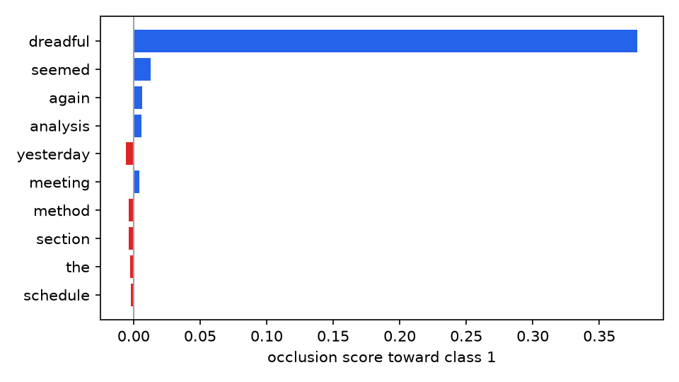
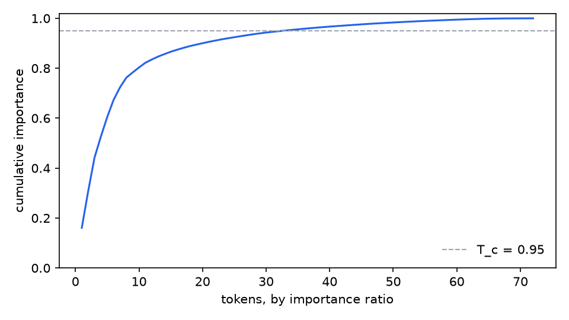
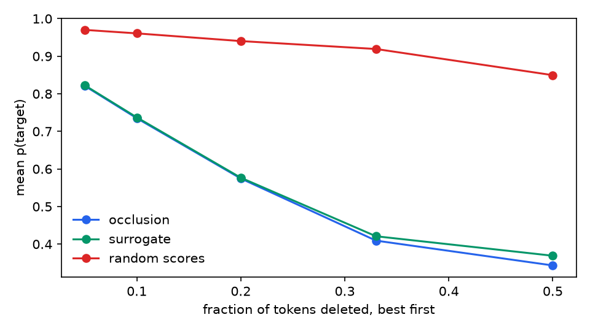

# explainkit demo report

A Naive Bayes classifier is trained on 200 synthetic workplace comments (hostile vs civil) whose signal words — and only those — carry the label, and reaches 1.00 accuracy on the 40 held-out texts.  Each held-out text is explained three ways, and every attribution is made to prove itself: deletion metrics for faithfulness, the implanted rationales for plausibility, and a targeted word swap for consequence.

## Scorecard

| attribution | AOPC | comp@3 | suff@3 | rationale F1@3 | top-3 jaccard vs occlusion | flip rate @3 |
|---|---|---|---|---|---|---|
| occlusion | 0.40 | 0.49 | -0.02 | 0.77 | 1.00 | 1.00 |
| surrogate | 0.39 | 0.49 | -0.02 | 0.77 | 0.90 | 1.00 |
| random scores | 0.04 | 0.03 | 0.24 | 0.20 | 0.20 | 0.20 |

AOPC and comp@3 are probability drops after deleting top-ranked tokens (higher = more faithful); suff@3 is the drop when *only* the top 3 remain (lower = the evidence suffices); rationale F1@3 compares the top 3 against the implanted signal words; the flip rate swaps each hostile-predicted text's top 3 tokens for civil counterparts and counts changed verdicts.  The row to sit with is the last one: random and informed attributions describe the same classifier, but replacing three informed tokens flips 100% of hostile verdicts while three random ones flip 20% — an attribution you cannot act on was never evidence.

## Token selection at T_c = 0.95

Of 72 distinct test-corpus tokens, 32 carry 95% of the corpus importance (correctness-gated mean |score|, occlusion).  The selection recovers 15 of the 22 implanted signal words that occur in the test slice; the remainder is the thin tail that the last few percent of importance drags in.

| rank | token | SI | IR | cumulative | n |
|---|---|---|---|---|---|
| 1 | useless | 0.3207 | 0.161 | 0.161 | 3 |
| 2 | generous | 0.2902 | 0.146 | 0.307 | 3 |
| 3 | attentive | 0.2689 | 0.135 | 0.442 | 2 |
| 4 | dreadful | 0.1677 | 0.084 | 0.526 | 5 |
| 5 | diligent | 0.1558 | 0.078 | 0.604 | 4 |
| 6 | reliable | 0.1369 | 0.069 | 0.673 | 4 |
| 7 | worthless | 0.0989 | 0.050 | 0.723 | 8 |
| 8 | thorough | 0.0782 | 0.039 | 0.762 | 7 |
| 9 | thoughtful | 0.0416 | 0.021 | 0.783 | 8 |
| 10 | creative | 0.0400 | 0.020 | 0.803 | 5 |
| 11 | organized | 0.0372 | 0.019 | 0.822 | 4 |
| 12 | clueless | 0.0259 | 0.013 | 0.835 | 2 |
| 13 | their | 0.0236 | 0.012 | 0.847 | 7 |
| 14 | handover | 0.0197 | 0.010 | 0.857 | 8 |
| 15 | today | 0.0191 | 0.010 | 0.866 | 6 |
| … | 17 more selected tokens | | | | |

## One text, explained

> schedule the meeting method section again seemed yesterday analysis dreadful

True label hostile; p(hostile) = 0.967.

| token | occlusion | surrogate |
|---|---|---|
| schedule | -0.002 | -0.010 |
| the | -0.002 | -0.005 |
| meeting | +0.004 | +0.016 |
| method | -0.004 | -0.018 |
| section | -0.004 | -0.012 |
| again | +0.006 | +0.019 |
| seemed | +0.013 | +0.041 |
| yesterday | -0.006 | -0.019 |
| analysis | +0.006 | +0.025 |
| dreadful | +0.379 | +0.405 |

